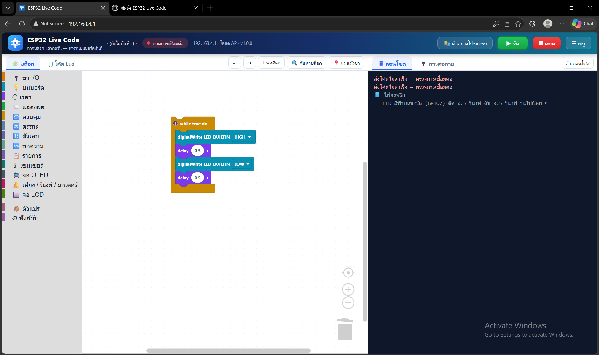
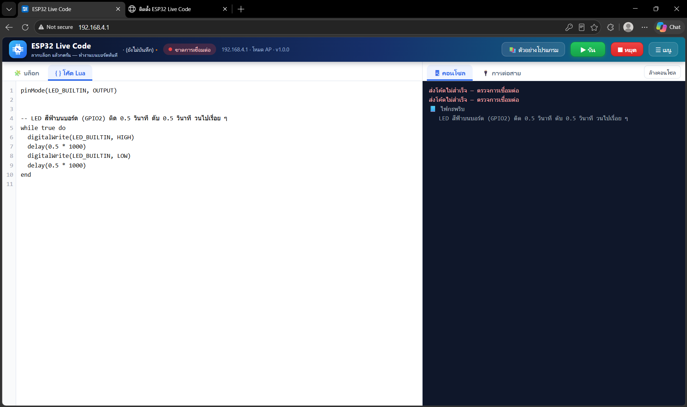
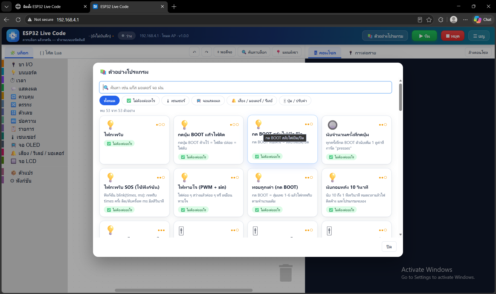
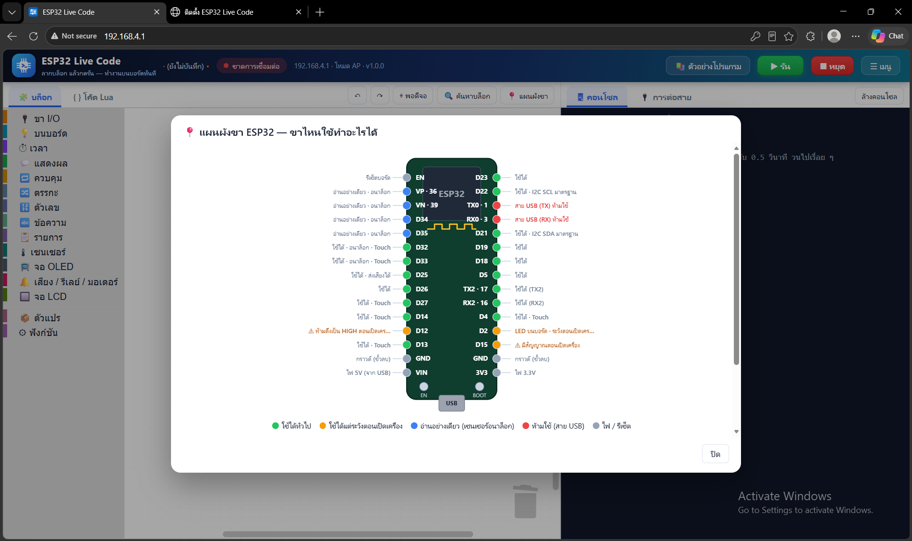
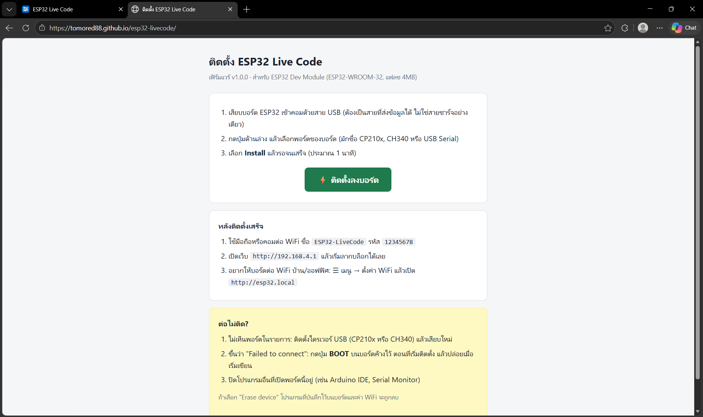

# ESP32 Live Code

> **English summary** — A browser-based IDE that runs on the ESP32 itself. Flash the firmware once, join the board's Wi-Fi, open its web page, drag Blockly blocks (or type Lua 5.4) and press **Run** — the program executes on the board instantly, no compiling or re-flashing. Includes 50+ examples, sensor/display/relay/motor blocks, a live wiring guide that tells you which pin to connect, and Thai text on OLED screens.
>
> **Install in your browser (Chrome/Edge): https://tomored88.github.io/esp32-livecode/** — then connect to the Wi-Fi `ESP32-LiveCode` (default password `12345678`, change it in `src/config.h`) and open `http://192.168.4.1`.
> License: MIT. Third-party notices: [THIRD_PARTY_NOTICES.md](THIRD_PARTY_NOTICES.md).

## ภาพหน้าจอ / Screenshots

| บล็อก (Blockly) | โค้ด Lua |
|---|---|
|  |  |

| ตัวอย่างโปรแกรม 53 แบบ | แผนผังขา ESP32 |
|---|---|
|  |  |

| หน้าติดตั้งผ่านเบราว์เซอร์ |
|---|
|  |

แฟลชเฟิร์มแวร์ลง ESP32 ครั้งเดียว จากนั้นเปิดเว็บที่บอร์ดเสิร์ฟเอง ลากบล็อก (หรือพิมพ์โค้ด Lua) แล้วกด **▶ รัน** โปรแกรมทำงานบนบอร์ดทันที ไม่ต้องคอมไพล์หรือแฟลชใหม่ ใช้งานได้แม้ไม่มีอินเทอร์เน็ต

- บอร์ด: **ESP32 Dev Module** (ESP32-WROOM-32, แฟลช 4MB)
- เขียนโปรแกรมด้วยบล็อก (Blockly) หรือโค้ด Lua 5.4
- เห็นผลบนหน้าเว็บ: คอนโซล + การ์ดค่าแบบ live พร้อมกราฟ
- บันทึกโปรแกรมไว้บนบอร์ด ตั้งให้รันเองตอนเปิดเครื่อง (autorun) ได้

---

## 1. ติดตั้งลงบอร์ด

### แบบที่ 1: ผ่านเว็บเบราว์เซอร์ (แนะนำ)

ใช้ Chrome หรือ Edge บนคอมพิวเตอร์

1. เปิด https://tomored88.github.io/esp32-livecode/ (หรือไฟล์ `index.html` ในโฟลเดอร์ `docs/` ผ่าน `https://` / `http://localhost` ตามด้านล่าง)
2. เสียบบอร์ด → กด **⚡ ติดตั้งลงบอร์ด** → เลือกพอร์ต → **Install**

เปิดหน้าติดตั้งในเครื่องตัวเอง:

```bash
python -m http.server 8000 -d docs
```

แล้วเปิด http://localhost:8000/

### แบบที่ 2: esptool (บรรทัดคำสั่ง)

ติดตั้ง esptool ครั้งแรกด้วย `pip install esptool` แล้ว:

```bash
python -m esptool --chip esp32 --port COM3 write_flash 0x0 docs/esp32-livecode-1.0.0.bin
```

เปลี่ยน `COM3` เป็นพอร์ตของบอร์ด (Linux/macOS เช่น `/dev/ttyUSB0`) ไฟล์ `.bin` นี้รวมทุกส่วนไว้แล้ว เขียนที่ตำแหน่ง `0x0` ตำแหน่งเดียว

### แบบที่ 3: สำหรับนักพัฒนา (PlatformIO)

```bash
pio run -e esp32dev -t upload
```

---

## 2. เริ่มใช้งาน

1. เปิดไฟเลี้ยงบอร์ด แล้วให้มือถือหรือคอมต่อ WiFi ชื่อ **`ESP32-LiveCode`** รหัส **`12345678`**
2. เปิดเว็บ **http://192.168.4.1**
3. เลือก **ตัวอย่างโปรแกรม…** เช่น "ไฟกะพริบ" แล้วกด **▶ รัน** (หรือ Ctrl+Enter) ไฟสีฟ้าบนบอร์ดจะกะพริบ
4. กด **■ หยุด** เพื่อหยุด (หยุดได้ทุกกรณี แม้โปรแกรมวนไม่รู้จบ)

### ให้บอร์ดต่อ WiFi บ้าน/ออฟฟิศ

☰ เมนู → **ตั้งค่า WiFi…** → **ค้นหา WiFi รอบตัว** → เลือกชื่อ → ใส่รหัส → **บันทึกและรีบูต**

- ต่อสำเร็จ: ให้คอม/มือถืออยู่ WiFi เดียวกัน แล้วเปิด **http://esp32.local** (หรือดู IP จาก Serial Monitor 115200)
- ต่อไม่ได้ภายใน 15 วินาที: บอร์ดกลับมาเปิด WiFi `ESP32-LiveCode` เอง เข้า http://192.168.4.1 แล้วตั้งค่าใหม่
- กลับไปใช้โหมด AP: ตั้งค่า WiFi → **ล้างค่า (ใช้โหมด AP)**

> Android บางรุ่นเปิด `esp32.local` ไม่ได้ (ไม่รองรับ mDNS) ให้ใช้ IP แทน

---

## 3. ตัวอย่างโปรแกรม (53 ตัว)

เลือกจาก **ตัวอย่างโปรแกรม…** บนแถบด้านบน คำอธิบายและวิธีต่อสายจะขึ้นในคอนโซล (และที่ไอคอน ? บนบล็อก)

**บนบอร์ด — ไม่ต้องต่ออะไรเพิ่ม**

| ตัวอย่าง | ได้เรียนรู้ |
|---|---|
| ไฟกะพริบ | วนซ้ำ, รอ |
| กดปุ่ม BOOT แล้วไฟติด | อ่านปุ่ม, if/else |
| กด BOOT สลับไฟเปิด/ปิด | ตัวแปร true/false, not, รอปล่อยปุ่ม |
| นับจำนวนครั้งที่กดปุ่ม | ตัวนับ, การ์ดค่า |
| ไฟกะพริบ SOS | สร้างฟังก์ชันที่มีพารามิเตอร์ |
| ไฟหายใจ | PWM, sin |
| ทอยลูกเต๋า | สุ่มตัวเลข, ทำซ้ำตามจำนวน |
| นับถอยหลัง 10 วินาที | for นับลง, โปรแกรมที่จบเอง |
| เกมวัดความไว | จับเวลา millis(), รอจนกว่า |

**ต่ออุปกรณ์เพิ่ม**

| ตัวอย่าง | ต่อที่ |
|---|---|
| อ่านอนาล็อกแสดงกราฟ | ตัวต้านทานปรับค่า 10k → GPIO34 |
| หมุนปรับความสว่างไฟ | ตัวต้านทานปรับค่า → GPIO34 (คุม LED บนบอร์ด) |
| ลดสัญญาณรบกวน (ค่าเฉลี่ย) | เซนเซอร์อนาล็อก → GPIO34 |
| แจ้งเตือนเมื่อค่าเกิน (มีช่วงกันสั่น) | เซนเซอร์อนาล็อก → GPIO34 |
| รีเลย์ตั้งเวลา เปิด/ปิด | โมดูลรีเลย์ → GPIO26 |
| ไฟวิ่ง 4 ดวง | LED + ตัวต้านทาน 220Ω → GPIO16, 17, 18, 19 |
| อุณหภูมิ/ความชื้น DHT22 (GPIO4) | DHT22: DATA → GPIO4, VCC → 3.3V (ตัวเปล่า 4 ขาต่อ 10k จาก DATA ไป VCC) |
| ความชื้นในดิน (GPIO34) | เซนเซอร์ความชื้นดิน AOUT → GPIO34 — ดินแห้งกว่า 30% ไฟติด |
| ปรับเทียบเซนเซอร์ความชื้นดิน | แสดงค่าดิบ ใช้หาค่า dry/wet ของเซนเซอร์ตัวเอง |
| รดน้ำต้นไม้อัตโนมัติ | ความชื้นดิน GPIO34 + รีเลย์ปั๊ม GPIO26 (ปิดเองเมื่อชื้นพอ หรือครบ 10 วินาที) |
| ไฟกลางคืนอัตโนมัติ (LDR GPIO35) | โมดูล LDR AO → GPIO35 |
| เล่นเพลงด้วยบัซเซอร์ (GPIO25) | บัซเซอร์แบบ passive + → GPIO25 |
| สัญญาณกันขโมย (PIR + บัซเซอร์) | PIR → GPIO27, บัซเซอร์ → GPIO25 |
| รีเลย์: กด BOOT สลับเปิด/ปิด | โมดูลรีเลย์ IN → GPIO26, VCC → 5V |
| มอเตอร์ DC: เร่ง-หมุนกลับ | บอร์ดขับ L9110S/DRV8833/L298N: IN1 → GPIO16, IN2 → GPIO17 |
| หมุนปุ่มคุมความเร็วมอเตอร์ | ตัวต้านทานปรับค่า → GPIO34 + มอเตอร์ผ่านบอร์ดขับ |
| พัดลมอัตโนมัติตามอุณหภูมิ | DHT22 → GPIO4 + มอเตอร์ผ่านบอร์ดขับ |
| เซอร์โวกวาด 0-180° (GPIO13) | เซอร์โว SG90: สัญญาณ → GPIO13, แดง → 5V |
| หมุนปุ่มคุมเซอร์โว | ตัวต้านทานปรับค่า → GPIO34, เซอร์โว → GPIO13 |
| เตือนแก๊สรั่ว/ควัน MQ-2 (GPIO34) | MQ-2 ผ่านตัวแบ่งแรงดัน 10k/20k → GPIO34, บัซเซอร์ → GPIO25 |
| ปรับเทียบ MQ-2 ในอากาศสะอาด | อุ่น 2 นาที แล้วบันทึกค่า R0 ไว้บนบอร์ด (ทำครั้งเดียว) |
| วัดแก๊สเป็น ppm (MQ-2) | หลังปรับเทียบ: LPG / CO / แอลกอฮอล์ โดยประมาณ |
| เซนเซอร์น้ำฝน (GPIO34) | บอร์ดเซนเซอร์ฝน AO → GPIO34, VCC → 3.3V — ฝนเริ่ม/หยุดตก |
| ปิดหน้าต่างอัตโนมัติเมื่อฝนตก | เซนเซอร์ฝน GPIO34 + เซอร์โว GPIO13 |
| ระดับน้ำในถัง + เตือนน้ำใกล้หมด | แผ่นระดับน้ำ S → GPIO35, + → GPIO27 + บัซเซอร์ GPIO25 |
| เติมน้ำถังอัตโนมัติ (ปั๊ม + ระดับน้ำ) | แผ่นระดับน้ำ + รีเลย์ปั๊ม GPIO26 (มีล็อกกันน้ำล้น) |
| ตรวจจับการเคลื่อนไหว PIR (GPIO27) | PIR HC-SR501: OUT → GPIO27, VCC → 5V (AM312 ใช้ 3.3V) — นับจำนวนครั้งที่มีคนขยับ |
| ไฟเปิดอัตโนมัติเมื่อมีคน | PIR ที่ GPIO27 — ไฟติดเมื่อมีคน ดับเองเมื่อไม่มีการเคลื่อนไหว 10 วินาที |
| อุณหภูมิ DS18B20 (GPIO4) | DS18B20: เหลือง → GPIO4 + 4.7k ไป 3.3V, แดง → 3.3V, ดำ → GND |
| DS18B20 หลายตัวบนสายเดียว | DS18B20 หลายตัวพ่วงสาย DATA เดียวกัน (GPIO4) |
| วัดระยะ HC-SR04 | HC-SR04: Trig → GPIO5, Echo → GPIO18 (ผ่านตัวแบ่งแรงดัน), VCC → 5V |
| เซนเซอร์ถอยจอดรถ (HC-SR04) | เหมือนข้างบน — ยิ่งใกล้ไฟยิ่งกะพริบเร็ว |
| สัมผัสแล้วไฟติด | สายไฟ/แผ่นโลหะ → GPIO4 (T0) |

**เซนเซอร์ I2C / จอ OLED** — ต่อทุกตัวบนสายเส้นเดียวกัน: SDA → GPIO21, SCL → GPIO22, VCC → 3.3V, GND → GND

| ตัวอย่าง | ใช้ |
|---|---|
| ค้นหาอุปกรณ์ I2C | อะไรก็ได้ที่เป็น I2C — บอกที่อยู่และชื่ออุปกรณ์ที่รู้จัก |
| อุณหภูมิ/ความชื้น DHT22 บนจอ OLED | DHT22 ที่ GPIO4 + จอ OLED |
| จอ OLED: ข้อความ + ตัวนับ | จอ OLED (ตัวอย่างจอทุกตัวเริ่มด้วยบล็อก `oled.begin` — จอ 1.3 นิ้วให้เปลี่ยนเป็น SH1106) |
| จอ OLED: ภาษาไทยกึ่งกลางจอ | จอ OLED |
| จอ LCD 16x2: ข้อความ + ตัวนับ | จอ LCD 16x2 + บอร์ด I2C หลังจอ (VCC → 5V) |
| อุณหภูมิ/ความชื้น AHT20 บนจอ LCD | AHT20 + จอ LCD 16x2 |
| จอ 0.91 นิ้ว (128x32): ข้อความ + ตัวนับ | จอแถบ 0.91 นิ้ว (ภาษาไทย 1 บรรทัด + ฟอนต์เล็ก 1 บรรทัด) |
| อุณหภูมิ/ความชื้น AHT20 บนจอ | AHT20 (หรือ AHT10) + จอ OLED |
| สถานีอากาศ BME280 | BME280/BMP280 + จอ OLED |
| วัดแสง BH1750 + แถบบนจอ | BH1750 + จอ OLED |
| ระดับน้ำดิจิทัล MPU6050 บนจอ | MPU6050 + จอ OLED |

---

## 4. หน้าเว็บ

| ส่วน | ใช้ทำอะไร |
|---|---|
| 📚 **ตัวอย่างโปรแกรม** (หัวเว็บ) | หน้ารวมตัวอย่างแบบการ์ด มีช่องค้นหาและตัวกรอง บอกว่าแต่ละตัวอย่างต้องใช้อุปกรณ์อะไร และระดับความยาก |
| แท็บ **บล็อก** | ลากบล็อกจากหมวดด้านซ้าย (ปุ่ม ↶ ↷ = ย้อนกลับ/ทำซ้ำ, ⌖ พอดีจอ, 🔍 ค้นหาบล็อก หรือกด Ctrl+K, 📍 แผนผังขา) |
| แท็บ **🔌 การต่อสาย** (ขวา) | อ่านบล็อกในโปรแกรมแล้วบอกว่า **อุปกรณ์แต่ละตัวต้องต่อสายเข้าขาไหนของบอร์ด** พร้อมแผนผังบอร์ด ของที่ต้องเตรียม และคำเตือน |
| แท็บ **โค้ด Lua** | ดูโค้ดที่ได้จากบล็อก แก้เองได้ (จะขึ้นแถบ "โค้ดเขียนเอง") ปุ่มรันจะรันตามแท็บที่เปิดอยู่ |
| การ์ดค่า (ขวาบน) | ค่าจากบล็อก `show` ถ้าเป็นตัวเลขจะมีกราฟเส้น 60 จุดล่าสุด |
| คอนโซล (ขวาล่าง) | ข้อความจาก `print` และ error เป็นภาษาไทย **คลิก error เพื่อไปที่บรรทัดนั้น** |
| ☰ เมนู | ใหม่ · เปิด/บันทึก/ลบบนบอร์ด (Ctrl+S) · autorun · ส่งออก/นำเข้า .json · ตั้งค่า WiFi · รีบูต |

### แท็บ "การต่อสาย" — ไม่ต้องเดาว่าจะต่อขาไหน

เลือกตัวอย่างที่ต้องต่ออุปกรณ์ แท็บนี้จะเปิดเองและบอกว่า:
- **แผนผังบอร์ด** (DOIT ESP32 DevKit V1 30 ขา) ไฮไลต์ขาที่ใช้ พร้อมชื่ออุปกรณ์ที่ต่ออยู่ที่ขานั้น กดปุ่ม "🔍 ขยายแผนผัง" เพื่อดูใหญ่ ๆ
- **วิธีต่อทีละอุปกรณ์**: ขาของอุปกรณ์ → ขาของบอร์ด พร้อมสีสาย เช่น `DATA → D4`, `VCC → 3V3`, `GND → GND` และของที่ต้องเสริม เช่น ตัวต้านทานแบ่งแรงดันของ HC-SR04 / MQ-2
- **ของที่ต้องเตรียม** และ **ข้อควรรู้** (ไฟ 5V ต่อที่ขา VIN, มอเตอร์/เซอร์โวควรใช้ไฟแยก ฯลฯ)
- **คำเตือนอัตโนมัติ** เมื่อ 2 อุปกรณ์ใช้ขาซ้ำกัน, ใช้ขาที่มีปัญหาตอนเปิดเครื่อง (D2, D12, D15), ใช้ขาอ่านอย่างเดียว (D34–D39) เป็นขาส่งออก หรือใช้ขา USB (TX0/RX0)

ระหว่างลากบล็อกเอง แท็บนี้อัปเดตตามบล็อกที่ใช้ และมีตัวเลขบอกจำนวนอุปกรณ์ที่ต้องต่อ

ปุ่ม **📍 แผนผังขา ESP32** (หรือเมนู ☰) แสดงขาทั้งหมดของบอร์ดแบบระบายสี: เขียว = ใช้ได้, ส้ม = ระวังตอนเปิดเครื่อง, น้ำเงิน = อ่านอย่างเดียว, แดง = ห้ามใช้ พร้อมรายการขาที่แนะนำสำหรับมือใหม่

> ลำดับขาในแผนผังตามบอร์ด DOIT DevKit V1 แบบ 30 ขา ถ้าบอร์ดของคุณเป็นรุ่นอื่น (เช่น 38 ขา) ให้ดูตัวเลขที่พิมพ์ข้างขาบนบอร์ด (เช่น D27) ซึ่งตรงกับในโปรแกรมเสมอ

- งานที่ทำอยู่จะถูกเก็บในเบราว์เซอร์อัตโนมัติ ปิดหน้าแล้วเปิดใหม่ยังอยู่ (แต่ยังไม่อยู่บนบอร์ดจนกว่าจะกดบันทึก จุดสีส้มข้างชื่อ = ยังไม่บันทึก)
- **autorun**: ☰ → ตั้งเป็นโปรแกรม autorun → บอร์ดจะรันงานนี้เองทุกครั้งที่เปิดเครื่อง แม้ไม่ได้เปิดเว็บ (ถ้าบอร์ดรีเซ็ตเพราะ crash จะข้าม autorun ให้ เพื่อไม่ให้บูตวน)
- ส่งออก .json เพื่อเก็บโปรแกรมไว้ในเครื่อง หรือส่งให้คนอื่นนำเข้า

---

## 5. คำสั่ง Lua บนบอร์ด

| คำสั่ง | ความหมาย |
|---|---|
| `print(...)` | พิมพ์ลงคอนโซล (และ Serial) |
| `show("ชื่อ", ค่า)` | แสดงการ์ดค่า (สูงสุด 24 ชื่อ) ตัวเลขมีกราฟ |
| `clear()` | ล้างคอนโซลและการ์ดค่า |
| `delay(ms)` | รอเป็นมิลลิวินาที (กดหยุดได้ระหว่างรอ) |
| `millis()`, `micros()` | เวลาตั้งแต่เปิดบอร์ด |
| `pinMode(pin, mode)` | `OUTPUT`, `INPUT`, `INPUT_PULLUP`, `INPUT_PULLDOWN` |
| `digitalWrite(pin, v)` | v = `HIGH`/`LOW`/1/0/true/false (ขาที่ยังไม่เคยตั้ง `pinMode` จะถูกตั้งเป็นขาส่งออกให้เอง) |
| `digitalRead(pin)` | ได้ 1 หรือ 0 |
| `analogRead(pin)` | 0–4095 (0–3.3V) ใช้ได้เฉพาะขา 32–39 |
| `analogWrite(pin, 0..255)` | PWM 5kHz เช่นหรี่ไฟ คุมความเร็วมอเตอร์ (PWM + บัซเซอร์ + เซอร์โว รวมกันได้ 8 ขาพร้อมกัน) |
| `tone(pin, Hz [, ms])`, `noTone(pin)` | เสียงจากบัซเซอร์แบบ passive (Hz = 0 คือเงียบ/พัก) — ใส่ ms แล้วรอจนจบเสียง |
| `relay.set(pin, true/false [, lowTrigger])` | เปิด/ปิดรีเลย์ (ค่าเริ่มต้น LOW-trigger = โมดูลส่วนใหญ่ ใส่ `false` สำหรับ HIGH-trigger) |
| `motor.run(in1, in2, speed [, en])`, `motor.stop(in1, in2 [, en])` | มอเตอร์ DC ผ่านบอร์ดขับ ความเร็ว −100…100 (ติดลบ = หมุนกลับ) · มีขา `en` = ขา PWM ของ L298N/TB6612 |
| `servo.write(pin, มุม [, minUs, maxUs])` | หมุนเซอร์โว 0–180° (ค่าเริ่มต้นพัลส์ 500–2400 µs ใช้กับ SG90/MG90S) |
| `touchRead(pin)` | ค่าสัมผัส ยิ่งแตะยิ่งน้อย (ไม่แตะ ~60–110) |
| `map(x, inLo, inHi, outLo, outHi)` | แปลงช่วงค่า |
| `dht.temperature(pin [, "dht11"])`, `dht.humidity(...)` | DHT22 (ค่าเริ่มต้น) หรือ DHT11 °C, % — อ่านใหม่ได้ทุก 2 วินาที ระหว่างนั้นได้ค่าล่าสุด |
| `soil.moisture(pin [, dry, wet])` | ความชื้นในดิน 0–100% (ค่าเริ่มต้น dry 2800, wet 1200 = เซนเซอร์ capacitive v1.2) |
| `rain.level(pin [, dry, wet])` | ความเปียกจากบอร์ดเซนเซอร์ฝน 0–100% (0 = แห้ง; ค่าเริ่มต้น dry 4095, wet 1500) |
| `water.level(pin [, powerPin [, empty, full]])` | ระดับน้ำ 0–100% จากแผ่นเซนเซอร์ระดับน้ำ (ค่าเริ่มต้น 0 / 2000); ใส่ `powerPin` = จ่ายไฟให้แผ่นแค่ ~20 ms ตอนวัด |
| `light.level(pin [, dark, bright])` | ความสว่าง 0–100% จากโมดูล LDR |
| `sensor.percent(pin, ค่าที่ 0%, ค่าที่ 100%)`, `sensor.raw(pin)` | แปลงเซนเซอร์อนาล็อกใดก็ได้เป็น % · ค่าดิบแบบนิ่ง (ค่ากลางของ 9 ครั้ง) |
| `mq2.level(pin)` | ระดับแก๊ส/ควัน 0–100% (ไม่ต้องปรับเทียบ) |
| `mq2.voltage(pin)` | แรงดัน AO ของโมดูลจริง 0–5V (คูณกลับจากตัวแบ่งแรงดันแล้ว) |
| `mq2.calibrate(pin)`, `mq2.ppm(pin, gas)` | ปรับเทียบในอากาศสะอาด (บันทึกไว้บนบอร์ด) · ppm โดยประมาณ gas = `"lpg"` `"co"` `"h2"` `"alcohol"` `"propane"` |
| `mq2.config(divider [, rlKOhm])` | ใช้ตัวแบ่งแรงดันค่าอื่น (10k/15k = 1.667) หรือโมดูลที่ RL ไม่ใช่ 1k — มีผลเฉพาะรอบที่รัน |
| `pir.motion(pin)` | `true` เมื่อเซนเซอร์ PIR เห็นการเคลื่อนไหว (สายหลุด = `false`) |
| `ds18b20.temperature(pin [, n])`, `ds18b20.count(pin)` | DS18B20 ตัวที่ n (เริ่ม 1) บนขานั้น °C, จำนวนตัวที่ต่ออยู่ — อ่านทุกตัวพร้อมกัน ~0.8 วินาที ค่าเก็บไว้ 1 วินาที |
| `ultrasonic.distance(trig, echo [, °C])` | ระยะจาก HC-SR04 เป็น cm (2–400) ได้ `-1` เมื่อไม่มีอะไรในระยะ ใส่อุณหภูมิอากาศได้เพื่อความแม่นยำ |
| `round(x, digits)` | ปัดเศษ เช่น `round(23.456, 1)` = 23.5 (`digits` = 0 ได้จำนวนเต็ม) |
| ค่าคงที่ | `HIGH`, `LOW`, `LED_BUILTIN` (= 2) |

ใช้ไลบรารีมาตรฐานของ Lua ได้: `string`, `table`, `math`, `utf8`, `coroutine` (ไม่มี `io`, `os`, `require` เพื่อความปลอดภัย)

### DHT22 / DHT11

ต่อ VCC → 3.3V, GND → GND, DATA → GPIO4 (หรือขาส่งออกอื่น) ถ้าเป็นตัวเปล่า 4 ขา (ไม่มีบอร์ด) ให้ต่อตัวต้านทาน 10kΩ จาก DATA ไป VCC

- DHT22 อ่านได้ทุก 2 วินาที (DHT11 ทุก 1 วินาที) ถ้าเรียกถี่กว่านั้นจะได้ค่าล่าสุด และอ่านอุณหภูมิ+ความชื้นในรอบเดียวกันได้ค่าจากการวัดครั้งเดียวกัน
- อ่านพลาดชั่วคราว (เกิดได้บ้าง) จะได้ค่าล่าสุดแทน ถ้าอ่านไม่ได้เลยโปรแกรมจะหยุดพร้อมบอกสาเหตุที่น่าจะเป็น

### เซนเซอร์อนาล็อก: ความชื้นในดิน, แสง (LDR) และอื่น ๆ

ต่อขาสัญญาณ (AO/AOUT) → ขา 32–39 (เช่น GPIO34), VCC → 3.3V, GND → GND อ่านค่ากลางของ 9 ครั้งเพื่อลดค่าแกว่ง แล้วแปลงเป็น 0–100%

**ปรับเทียบ (สำคัญ)**: เซนเซอร์แต่ละตัวให้ค่าดิบต่างกัน — ใช้ตัวอย่าง "ปรับเทียบเซนเซอร์ความชื้นดิน" จดค่า raw ตอนอยู่ในอากาศ (= dry) และตอนแช่น้ำ (= wet) แล้วใส่ในบล็อก `soil.moisture`

- เซนเซอร์แบบ capacitive (v1.2 สีดำ) ทนกว่าแบบ 2 ขาเหล็ก (resistive) ที่จะผุเมื่อเสียบดินนาน ๆ
- ไม่ได้ต่อเซนเซอร์ ขาจะอ่านได้ 0 → ความชื้นขึ้น 100% (ตัวอย่างรดน้ำจึงไม่เปิดปั๊มเมื่อสายหลุด)
- ตัวอย่างรดน้ำมีเวลาเปิดปั๊มสูงสุด 10 วินาทีต่อครั้ง กันน้ำท่วมถ้าเซนเซอร์เสีย

### เซนเซอร์ฝนและระดับน้ำ

**เซนเซอร์ฝน** (บอร์ด FC-37 / YL-83 พร้อมโมดูล LM393): AO → GPIO34, VCC → **3.3V**, GND → GND
- ได้ความเปียก 0–100% (0 = แห้ง) ค่าเริ่มต้น dry 4095 / wet 1500 ปรับในบล็อกให้ตรงกับเซนเซอร์ตัวเอง (หาค่าด้วยบล็อก `sensor.raw` ตอนแห้งและตอนหยดน้ำ)
- ใช้ไฟ 3.3V ไม่ใช่ 5V เพราะที่ 5V ขา AO อาจเกิน 3.3V ที่ ESP32 รับได้ (ถ้าต้องใช้ 5V ให้ทำตัวแบ่งแรงดันแบบ MQ-2)
- ขา DO ใช้แทนได้ (ปรับความไวด้วยตัวต้านทานบนบอร์ด) อ่านด้วย `digitalRead` — LOW = เปียก
- รางทองแดงบนแผ่นผุได้ถ้าเปียกนาน ๆ ควรติดตั้งเอียงให้น้ำไหลออกและถอดไฟเมื่อไม่ใช้

**เซนเซอร์ระดับน้ำ** (แผ่น 3 ขา S, +, −): S → GPIO35, − → GND, + → ขา GPIO สำหรับจ่ายไฟ เช่น GPIO27 (แนะนำ) หรือ 3.3V
- แผ่นมีรางโลหะเปลือยจุ่มน้ำ ถ้าจ่ายไฟค้างไว้จะผุกร่อนเร็ว → ต่อ + เข้าขา GPIO แล้วเลือกขานั้นในบล็อก (`water.level(35, 27)`) ระบบจ่ายไฟแค่ประมาณ 20 ms ตอนวัด แล้วตัดทันที
- ได้ 0–100% ระหว่างค่า "ว่าง" และ "เต็ม" ค่าเริ่มต้น 0 / 2000 ควรวัดค่าของตัวเองด้วย `sensor.raw` (แผ่นแห้ง = ว่าง, จุ่มถึงขีดสูงสุด = เต็ม) — ค่านี้ขึ้นกับน้ำที่ใช้ (น้ำประปา น้ำฝน น้ำกลั่นนำไฟฟ้าไม่เท่ากัน)
- วัดได้เฉพาะช่วงความยาวของแผ่น (ประมาณ 4 ซม. ในแผ่นทั่วไป) ถังใหญ่ควรใช้เซนเซอร์แบบอื่น
- ตัวอย่าง "เติมน้ำถังอัตโนมัติ" มี **ล็อกกันน้ำล้น**: ถ้าปั๊มเปิดครบ 60 วินาทีแล้วระดับน้ำยังไม่ถึง 85% (แผ่นเสีย/หลุด ถังรั่ว ปั๊มไม่ดูด) จะปิดปั๊มและไม่เปิดอีกจนกว่าจะกดรันใหม่
- ⚠️ ถ้าไม่ได้ต่อเซนเซอร์ ขาจะลอยและอ่านค่าไม่แน่นอน ตรวจไม่ได้ว่าสายหลุด (ต่างจากเซนเซอร์ I2C/DHT/DS18B20 ที่ขึ้น error) งานที่เกี่ยวกับน้ำจึงควรมีตัวจำกัดเวลาเสมอ

### เซนเซอร์แก๊ส MQ-2 + วงจรแบ่งแรงดัน

โมดูล MQ-2 ใช้ไฟ 5V และขา AO ส่งแรงดันได้ถึง 5V แต่ขา ESP32 รับได้แค่ 3.3V จึงต้องลดแรงดันด้วยตัวต้านทาน 2 ตัว:

```
MQ-2 VCC ──── 5V (ขา VIN)
MQ-2 GND ──── GND
MQ-2 AO  ──[ 10kΩ ]──┬──── GPIO34
                     │
                  [ 20kΩ ]
                     │
                    GND
MQ-2 DO  ──── (ไม่ต่อ — เป็นสัญญาณ 5V)
```

แรงดันที่ขา GPIO34 = AO × 20/(10+20) = AO × 2/3 → AO 5V เหลือ 3.33V ระบบคูณกลับให้เอง (×1.5) ถ้าใช้ 10k/15k ให้เรียก `mq2.config(1.667)`

- **อุ่นเครื่อง**: หลังเปิดไฟรอ 1–3 นาทีค่าถึงจะนิ่ง เซนเซอร์ใหม่ควรเปิดทิ้งไว้ 24 ชม. ครั้งแรก
- **`mq2.level`**: ใช้ได้เลยไม่ต้องปรับเทียบ อากาศสะอาดมักได้ 5–20% (ขึ้นกับตัวเซนเซอร์)
- **`mq2.ppm`**: ต้องรันตัวอย่าง "ปรับเทียบ MQ-2 ในอากาศสะอาด" ก่อน 1 ครั้ง ค่า ppm คำนวณจากกราฟใน datasheet (ppm = a·(Rs/R0)^b) เป็น**ค่าประมาณ** — MQ-2 ไวต่อแก๊สหลายชนิดพร้อมกัน แยกชนิดไม่ได้จริง
- ถ้าถอดเซนเซอร์ออก (ตัวต้านทาน 20k ยังต่ออยู่) ขาจะเป็น 0V โปรแกรมจะหยุดพร้อมบอกให้ตรวจสาย
- ⚠️ ใช้เพื่อการเรียนรู้เท่านั้น **ไม่ใช่เครื่องตรวจแก๊สที่ได้มาตรฐาน** ห้ามใช้แทนอุปกรณ์ความปลอดภัยในบ้าน/โรงงาน

### รีเลย์และมอเตอร์ DC

**รีเลย์**: IN → ขาส่งออก เช่น GPIO26, VCC → 5V, GND → GND โมดูลส่วนใหญ่เป็นแบบ **LOW-trigger** (ทำงานเมื่อขาเป็น LOW) บล็อก `relay` จัดการให้ ถ้ารีเลย์ติด/ดับกลับด้าน ให้เปลี่ยนเป็น HIGH-trigger
- ⚠️ ต่อไฟบ้าน 220V ที่ขั้ว COM/NO/NC อันตรายถึงชีวิต ให้ผู้มีความรู้ต่อ และใช้กล่องปิดมิดชิด

**มอเตอร์ DC**: ต้องผ่านบอร์ดขับมอเตอร์เสมอ (ห้ามต่อมอเตอร์เข้าขา ESP32 ตรง ๆ) และต่อ GND ของบอร์ดขับร่วมกับ ESP32

| บอร์ดขับ | ต่อ | บล็อก / Lua |
|---|---|---|
| L9110S, DRV8833, L298N (เสียบจัมเปอร์ ENA ไว้) | IN1 → GPIO16, IN2 → GPIO17 | EN = ไม่ใช้ · `motor.run(16, 17, speed)` |
| L298N (ถอดจัมเปอร์ ENA), TB6612 | IN1 → 16, IN2 → 17, ENA/PWMA → 18 | EN = GPIO18 · `motor.run(16, 17, speed, 18)` |

- ไฟเลี้ยงมอเตอร์ต่อเข้าบอร์ดขับโดยตรง (ถ่าน/อะแดปเตอร์) อย่าดึงจากขา 3.3V ของ ESP32
- มอเตอร์ส่วนใหญ่เริ่มหมุนที่ความเร็ว ~30–40% ต่ำกว่านั้นอาจแค่หึ่ง

**ความปลอดภัย**: กด ■ หยุด หรือโปรแกรม error → มอเตอร์ที่โปรแกรมสั่งหยุด และรีเลย์ที่สั่งไว้ปิดเองทันที (ส่วนโปรแกรมที่จบตามปกติจะคงสถานะไว้ตามที่สั่ง)

### บัซเซอร์และเซอร์โว

- **บัซเซอร์แบบ passive** (ไม่มีเสียงเองเมื่อจ่ายไฟตรง): + → ขาส่งออก เช่น GPIO25, − → GND ใช้ `tone` เล่นโน้ต/เพลงได้ · แบบ **active** (มีเสียงเองเมื่อจ่ายไฟ) ใช้ `digitalWrite` HIGH/LOW
- **เซอร์โว SG90/MG90S**: สายส้ม/เหลือง → ขาส่งออก เช่น GPIO13, แดง → **5V (ขา VIN)**, น้ำตาล → GND — อย่าเลี้ยงด้วย 3.3V บอร์ดอาจรีเซ็ตเพราะไฟตก
- กดหยุดโปรแกรมแล้วเสียงบัซเซอร์หยุดทันที · เซอร์โวจะปล่อยแรงบิดเมื่อเริ่มรันโปรแกรมใหม่
- PWM, บัซเซอร์ และเซอร์โว แต่ละขาใช้ตัวจับเวลาของตัวเอง จึงใช้พร้อมกันได้ (รวมไม่เกิน 8 ขา)

### PIR ตรวจจับการเคลื่อนไหว

ต่อ OUT → GPIO27 (หรือขาอื่น), GND → GND, VCC → 5V สำหรับ HC-SR501 (สัญญาณ OUT เป็น 3.3V ต่อตรงได้) หรือ 3.3V สำหรับ AM312

- หลังเปิดไฟ HC-SR501 ต้องรอประมาณ 30–60 วินาทีให้นิ่ง ช่วงแรกอาจแจ้งว่ามีการเคลื่อนไหวเอง
- ตัวต้านทานปรับค่าบน HC-SR501: Sx = ระยะตรวจจับ (3–7 ม.), Tx = เวลาที่ OUT ค้าง HIGH หลังเห็นการเคลื่อนไหว
- ตัวอย่างนับครั้งใช้การเปลี่ยนจาก `false` เป็น `true` (ไม่ใช่นับทุกรอบที่ยังเป็น `true`)

### DS18B20 (1-Wire)

ต่อ VDD (สายแดง) → 3.3V, GND (สายดำ) → GND, DATA (สายเหลือง) → GPIO4 (หรือขาส่งออกอื่น) และ **ตัวต้านทาน 4.7kΩ จาก DATA ไป 3.3V** (โมดูลที่มีบอร์ดมักใส่มาแล้ว)

- ต่อหลายตัวพ่วงสาย DATA เส้นเดียวกันได้สูงสุด 8 ตัว ใช้ตัวต้านทาน 4.7k ตัวเดียว ลำดับตัวที่ 1, 2, ... คงที่ตามหมายเลขประจำตัวของเซนเซอร์
- ไม่รองรับการต่อแบบไม่ใช้ไฟเลี้ยง (parasite power) — ต้องต่อสาย VDD เสมอ
- สายยาวหลายเมตรแล้วอ่านพลาด ลองลดตัวต้านทานเป็น 2.2kΩ

### อัลตราโซนิก HC-SR04

ต่อ VCC → **5V**, GND → GND, Trig → GPIO5, Echo → GPIO18 (ใช้ขาอื่นได้ เลือกในบล็อก)

ขา Echo ของ HC-SR04 ส่งสัญญาณ 5V แต่ ESP32 รับได้ 3.3V ให้ต่อผ่านตัวต้านทานแบ่งแรงดัน: Echo → 1kΩ → GPIO18 และ GPIO18 → 2kΩ → GND (รุ่น HC-SR04P / RCWL-1601 ที่ใช้ไฟ 3.3V ต่อตรงได้)

- วัดได้ 2–400 cm ห่างกันอย่างน้อย 60 ms ต่อครั้ง (ระบบรอให้เอง) ได้ `-1` เมื่อไม่มีวัตถุในระยะ
- ถ้าไม่มีสัญญาณตอบกลับเลย (สายหลุด/ไม่มีไฟ) โปรแกรมจะหยุดพร้อมบอกให้ตรวจสาย

### เซนเซอร์ I2C และจอ OLED

ต่อ SDA → GPIO21, SCL → GPIO22, VCC → 3.3V, GND → GND (ต่อหลายตัวพ่วงกันได้) ถ้าไม่พบอุปกรณ์ โปรแกรมจะหยุดพร้อมบอกว่าต้องตรวจสายไหน

| คำสั่ง | ความหมาย |
|---|---|
| `i2c.scan(true)` | ค้นหาอุปกรณ์ แล้วพิมพ์ที่อยู่ + ชื่อที่รู้จัก (คืนค่าเป็นรายการที่อยู่) |
| `i2c.begin(sda, scl [, hz])` | ใช้ขาอื่น (ค่าเริ่มต้น 21, 22, 400000) — มีผลเฉพาะรอบที่รัน |
| `i2c.readReg(addr, reg [, n])`, `i2c.writeReg(addr, reg, v)` | อ่าน/เขียน register |
| `i2c.read(addr, n)`, `i2c.write(addr, b1, b2, ...)` | อ่าน/เขียนไบต์ดิบ |
| `aht20.temperature()`, `aht20.humidity()` | AHT20/AHT10 (0x38) °C, % |
| `sht31.temperature()`, `sht31.humidity()` | SHT30/31/35 (0x44/0x45) |
| `bme280.temperature()`, `.humidity()`, `.pressure()` | BME280/BMP280 (0x76/0x77) °C, %, hPa (BMP280 ไม่มีความชื้น) |
| `bh1750.lux()` | ความสว่าง lux (0x23/0x5C) |
| `mpu6050.angle("pitch"/"roll")` | มุมเอียง องศา (0x68/0x69) |
| `mpu6050.accel("x"/"y"/"z")`, `mpu6050.gyro(...)` | ความเร่ง g, ความเร็วหมุน °/s (ไม่ใส่แกน = คืน 3 ค่า) |
| `oled.begin(ชนิด [, addr])` | เลือกจอ: `"ssd1306"` = 0.96 นิ้ว 128x64 (ค่าเริ่มต้นถ้าไม่เรียก), `"sh1106"` = 1.3 นิ้ว 128x64, `"ssd1306_32"` = 0.91 นิ้ว 128x32 — ใช้เฉพาะรอบที่รัน |
| `oled.height()` | ความสูงของจอที่เลือก (64 หรือ 32) |
| `oled.clear()`, `oled.text(x, y, ค่า [, size [, font]])` | จอ 128x64 (0x3C/0x3D) x 0–127, y = มุมบน 0–63, size 1–4 |
| `oled.width(ค่า [, size [, font]])` | ความกว้างข้อความเป็นจุด ใช้จัดกึ่งกลาง `x = (128 - oled.width(s)) / 2` |
| `oled.line`, `oled.rect`, `oled.circle`, `oled.pixel`, `oled.bar(x, y, w, h, %)` | วาดรูป (`rect`/`circle` ใส่ `true` ท้ายสุด = ทึบ) |
| `oled.show()` | ส่งภาพขึ้นจอทันที (ปกติจอจะอัปเดตเองตอน `delay` และตอนจบโปรแกรม) |

**จอ LCD 16x2 / 20x4 (บอร์ด I2C PCF8574 หลังจอ)** — ต่อ SDA → GPIO21, SCL → GPIO22, VCC → **5V**, GND

| คำสั่ง | ความหมาย |
|---|---|
| `lcd.begin([cols, rows [, addr]])` | ขนาดจอ (ค่าเริ่มต้น 16, 2 — 20x4 ใช้ `lcd.begin(20, 4)`) หาที่อยู่ให้เอง (0x27, 0x3F, ...) |
| `lcd.text(col, row, ค่า)` | เขียนที่ช่อง col (0–15) บรรทัด row (0–1) ข้อความที่ยาวเกินจอถูกตัด |
| `lcd.clear()`, `lcd.backlight(true/false)` | ล้างจอ, เปิด/ปิดไฟจอ |

> จอ LCD ไม่มีตัวอักษรไทย (ขึ้นเป็น `?`) ใช้ภาษาอังกฤษ/ตัวเลข — `°` แสดงได้
> ตัวเลขที่สั้นลง (เช่น 10 → 9) จะมีหลักเก่าค้าง ให้ต่อช่องว่างท้ายข้อความ
> จอติดแต่เห็นแค่สี่เหลี่ยม/ว่างเปล่า = หมุนตัวต้านทานปรับความเข้ม (สีฟ้า) หลังจอ
> บอร์ด I2C ของจอ LCD ดึงสาย SDA/SCL ขึ้นไป 5V ส่วนใหญ่ใช้กับ ESP32 ได้ แต่ถ้าต้องการความปลอดภัยสูงสุดให้ใช้ตัวแปลงระดับ (level shifter)

**ภาษาไทยบนจอ OLED** — `font` เลือกได้ 3 แบบ:

- `"auto"` (ค่าเริ่มต้น): ข้อความที่มีภาษาไทย → ฟอนต์ไทย สูง 20 จุดต่อบรรทัด (จอ 64 จุด ได้ 3 บรรทัด: y = 0, 22, 44), อังกฤษล้วน → ฟอนต์เล็ก 6x8
- `"thai"`: ใช้ฟอนต์ไทยเสมอ (ให้ตัวเลข/อังกฤษสูงเท่าบรรทัดภาษาไทย)
- `"small"`: ฟอนต์เล็ก 6x8 อังกฤษเท่านั้น

ฟอนต์ไทยแปลงจาก K2D Bold (SIL Open Font License 1.1, https://github.com/cadsondemak/K2D) ด้วย `tools/make_thai_font.py` สระบน/ล่างและวรรณยุกต์วางซ้อนบนพยัญชนะให้อัตโนมัติ (วรรณยุกต์ลดลงมาเมื่อไม่มีสระบน, เลื่อนซ้ายบน ป ฝ ฟ ฬ) ข้อจำกัด: ญ ฐ ที่มีสระล่างยังไม่ตัดเชิง

### ขาที่ใช้ได้

| ใช้ทำ | ขา |
|---|---|
| ส่งออก / PWM | 2, 4, 5, 12–19, 21–23, 25–27, 32, 33 |
| รับเข้าอย่างเดียว | 34, 35, 36, 39 |
| อนาล็อก | 32–39 (ขา ADC2 อ่านไม่ได้ตอนเปิด WiFi) |
| สัมผัส | T0=4, T1=0, T2=2, T3=15, T4=13, T5=12, T6=14, T7=27, T8=33, T9=32 |
| ห้ามใช้ | 6–11 (ต่อกับแฟลชของบอร์ด), 1 และ 3 (สาย USB Serial) |
| บนบอร์ด | LED = GPIO2, ปุ่ม BOOT = GPIO0 (กด = LOW) |

> ขา 0, 2, 12, 15 มีผลตอนบูต ถ้าต่ออุปกรณ์แล้วบอร์ดไม่บูต ให้ย้ายไปขาอื่น

---

## 6. ปัญหาที่พบบ่อย

| อาการ | แก้ |
|---|---|
| ไม่เห็น WiFi `ESP32-LiveCode` | ถ้าเคยตั้ง WiFi บ้านไว้ บอร์ดจะต่อ WiFi นั้นแทน ลองเปิด http://esp32.local หรือดู IP ทาง Serial |
| หน้าเว็บขึ้น "ขาดการเชื่อมต่อ" | มือถือหลุดจาก WiFi ของบอร์ด (บางเครื่องสลับไป WiFi ที่มีเน็ตเอง) ให้ต่อใหม่ |
| บันทึกไม่ได้ "พื้นที่บนบอร์ดเต็ม" | ☰ → เปิดจากบอร์ด → ลบโปรแกรมที่ไม่ใช้ (พื้นที่เก็บรวม ~100KB) |
| โปรแกรม autorun ทำให้ใช้งานไม่ได้ | เปิดเว็บแล้วกด ■ หยุด → ☰ → ยกเลิก autorun |
| error ขึ้นเลขบรรทัด แต่ใช้บล็อกอยู่ | คลิกที่ error จะเปิดแท็บโค้ด Lua และไฮไลต์บรรทัดนั้น |

---

## 7. สำหรับนักพัฒนา

```
platformio.ini            env esp32dev, partitions min_spiffs, LittleFS
src/main.cpp              WiFi, web API, Lua runner, bindings, ไฟล์
src/i2c_dev.cpp           I2C, ไดรเวอร์เซนเซอร์, จอ OLED (Adafruit SSD1306)
src/config.h              WiFi เริ่มต้น, ชื่อ AP, mDNS
src/web_assets.h          (สร้างอัตโนมัติ) ไฟล์เว็บแบบ gzip
lib/lua/                  Lua 5.4.6 (ไม่มี io/os/package)
web/index.html            หน้า IDE ทั้งหมด (HTML+CSS+JS ไฟล์เดียว)
web/vendor/blockly/       Blockly 13.4.0 (Apache-2.0)
tools/embed_web.py        ฝังไฟล์เว็บเป็น web_assets.h (รันเองก่อน build)
tools/dev_server.py       ทดลองหน้าเว็บบนคอมโดยไม่ต้องแฟลช
tools/make_release.py     สร้าง docs/ (.bin รวม + manifest + index.html)
tools/make_thai_font.py   แปลงฟอนต์ TTF ภาษาไทยเป็น src/font_thai.h (--preview ดูตัวอย่างเป็นภาพ)
tools/oled_font_test.py   เทียบการวาดภาษาไทยบนบอร์ดกับบนคอมทีละจุด (ไม่ต้องมีจอ)
tools/serial_test.py      ทดสอบ runner ผ่าน USB
tools/autorun_test.py     ทดสอบ autorun หลังรีเซ็ต ผ่าน USB
tools/http_test.py        ทดสอบ web API บนบอร์ดจริง (ต้องต่อ WiFi ของบอร์ด)
```

### แก้หน้าเว็บโดยไม่ต้องแฟลช

```bash
python tools/dev_server.py
```

เปิด http://localhost:8080 (บอร์ดจำลอง) หรือใส่ `--port COM3` เพื่อส่งโค้ดไปรันบนบอร์ดจริงผ่าน USB แก้ `web/index.html` แล้วกดรีเฟรชได้เลย

### ทดสอบ

```bash
python -X utf8 tools/serial_test.py COM3
```

```bash
python -X utf8 tools/autorun_test.py COM3
```

```bash
python -X utf8 tools/http_test.py http://192.168.4.1
```

`serial_test` / `autorun_test` ใช้ Serial console ของเฟิร์มแวร์: พิมพ์โค้ดหลายบรรทัด แล้วตามด้วยบรรทัด `--run` (รัน), `--stop`, `--autorun`, `--noautorun`, `--reboot`

### ออก release

แก้ `FW_VERSION` ใน `src/main.cpp` แล้วรัน:

```bash
python tools/make_release.py
```

ได้ `docs/esp32-livecode-<ver>.bin`, `manifest.json`, `index.html` (GitHub Pages เสิร์ฟโฟลเดอร์ `docs/`) หรือนำไปวางบนเว็บที่เป็น https (เช่น GitHub Pages) ให้ติดตั้งผ่านเบราว์เซอร์ได้

### Web API


| Method | Path | รายละเอียด |
|---|---|---|
| GET | `/` | หน้า IDE (gzip, no-cache) |
| GET | `/blockly.js`, `/media/*` | ไฟล์ Blockly (gzip, cache 1 วัน) |
| POST | `/api/run` | body = โค้ด Lua (text/plain) |
| POST | `/api/stop` | หยุดโปรแกรม |
| GET | `/api/log?since=N&vs=M` | `{boot, seq, clear, running, lines:[{s,t,m}], vs, vals?:{k:v}}` — `boot` เปลี่ยน = บอร์ดรีสตาร์ต — t: 0=print 1=error 2=system; ส่ง `vals` เฉพาะเมื่อ vs เปลี่ยน; `clear`>since = ล้าง console ฝั่งเว็บ |
| GET | `/api/info` | `{ver, ip, mode(sta/ap), ssid, saved, heap, autorun, fs}` — `saved` = WiFi ที่ตั้งไว้ |
| GET | `/api/files` | รายชื่อโปรแกรมที่บันทึก |
| GET/POST/DELETE | `/api/file?name=x&kind=lua\|blk` | อ่าน/บันทึก/ลบ (`name=__autorun` = ไฟล์ autorun) ชื่อใช้ได้ `a-z0-9_-` ≤24 ตัว · POST ต้องเป็น multipart/form-data (เขียนลงแฟลชทีละส่วน) ≤64KB; 413 = ใหญ่เกิน, 507 = พื้นที่เต็ม |
| POST | `/api/wifi` | form `ssid`,`pass` → เก็บใน NVS (Preferences) แล้วรีบูต; `ssid` ว่าง = ลืม WiFi กลับเป็นโหมด AP |
| GET | `/api/scan` | `[{ssid, rssi, lock}]` WiFi รอบตัว (~4 วิ) |
| POST | `/api/reboot` | รีบูต |

ที่เก็บไฟล์ (LittleFS): `/p/<name>.lua`, `/p/<name>.blk` (JSON ของ workspace), `/autorun.lua`, `/autorun.blk`

---

## สัญญาอนุญาต

- Lua 5.4 — MIT, © Lua.org, PUC-Rio
- Blockly — Apache License 2.0, © Google LLC (`web/vendor/blockly/LICENSE`)


## License

MIT — see [LICENSE](LICENSE). Bundled third-party components: [THIRD_PARTY_NOTICES.md](THIRD_PARTY_NOTICES.md).
